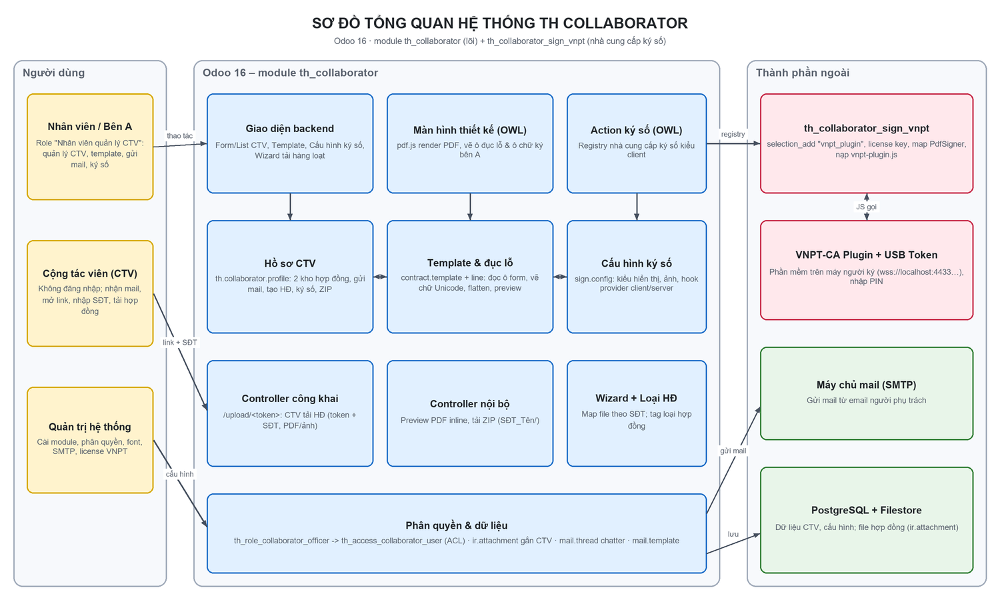
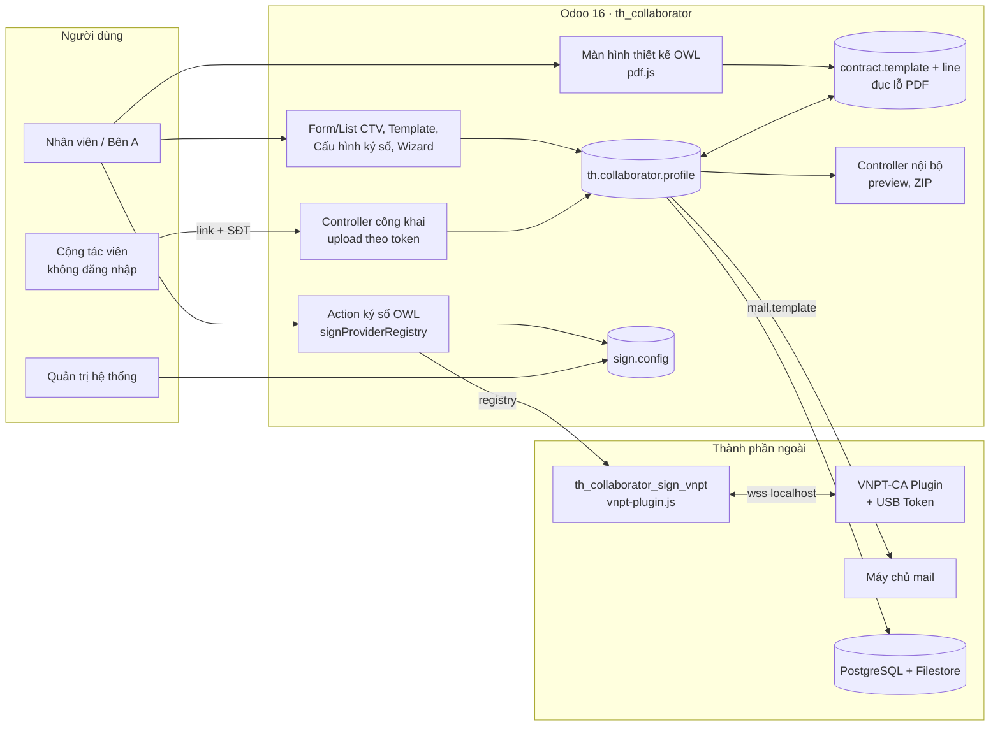
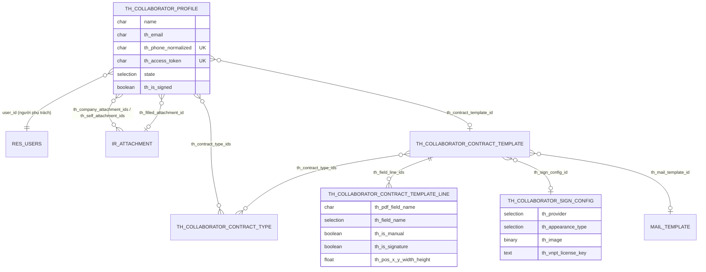
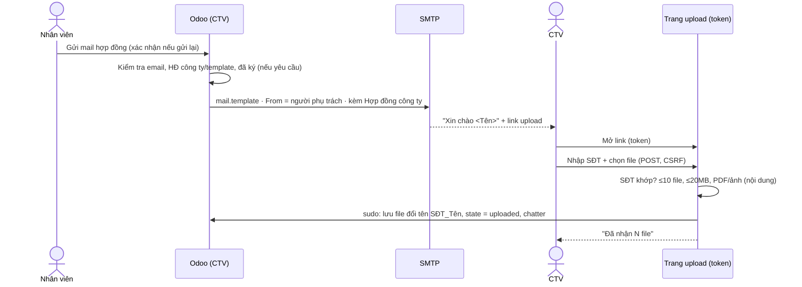
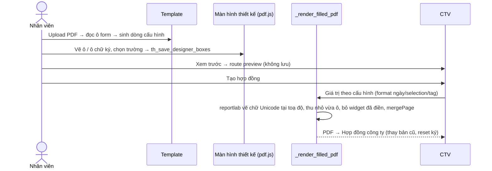
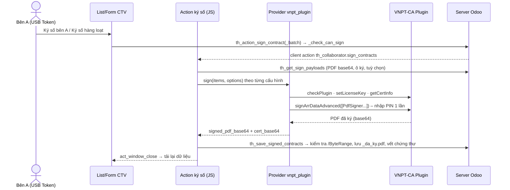
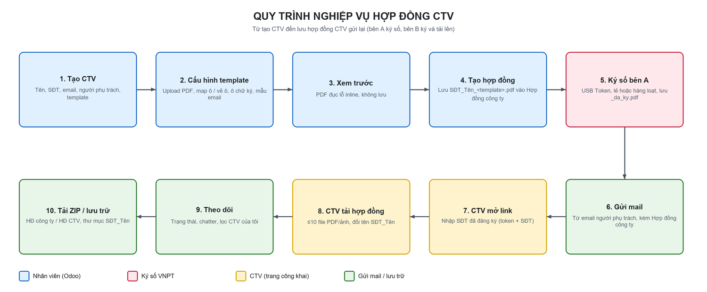

# 01. Thiết kế hệ thống TH Collaborator

> **Dự án:** TH Collaborator - Quản lý cộng tác viên & hợp đồng  
> **Module:** th_collaborator (16.0.1.3.0), th_collaborator_sign_vnpt (16.0.1.0.0)  
> **Nền tảng:** Odoo 16 (Community/Enterprise), Python 3.10, PostgreSQL  
> **Cập nhật:** 18/10/2026 · **Tác giả:** Sonbn

## 1. Mục đích & phạm vi

Hệ thống quản lý cộng tác viên (CTV) và vòng đời hợp đồng trên Odoo 16: lưu hồ sơ CTV, soạn hợp đồng tự động từ template PDF (đục lỗ), bên A ký số bằng USB Token, gửi mail cho CTV, CTV không đăng nhập vẫn tải hợp đồng đã ký lên, xử lý file hàng loạt.

## 2. Sơ đồ tổng quan

## 3. Kiến trúc 2 module

| Module | Vai trò | Phụ thuộc |
|---|---|---|
| th_collaborator | Lõi nghiệp vụ + khung ký số độc lập nhà cung cấp | mail |
| th_collaborator_sign_vnpt | Nhà cung cấp ký số VNPT-CA Plugin (USB Token) | th_collaborator |

## 4. Thành phần

| Thành phần | Loại | File chính | Trách nhiệm |
|---|---|---|---|
| Hồ sơ CTV | Model | models/th_collaborator_profile.py | Lưu thông tin CTV, 2 kho hợp đồng, gửi mail, tạo hợp đồng từ template, ký số bên A, tải ZIP |
| Loại hợp đồng | Model | models/th_collaborator_contract_type.py | Danh mục loại hợp đồng dạng tag có màu, cấu hình được |
| Template hợp đồng | Model | models/th_collaborator_contract_template.py | Lưu PDF mẫu, đọc ô form, đục lỗ (vẽ chữ Unicode + flatten), dữ liệu màn hình thiết kế, ô chữ ký |
| Dòng cấu hình đục lỗ | Model | models/th_collaborator_contract_template_line.py | Map ô form/ô vẽ tay -> trường CTV; toạ độ ô vẽ tay; ô chữ ký bên A; định dạng giá trị |
| Cấu hình ký số | Model | models/th_collaborator_sign_config.py | Khung ký số độc lập nhà cung cấp: kiểu hiển thị, ảnh, tuỳ chọn; hook cho module nhà cung cấp |
| Wizard tải hàng loạt | TransientModel | wizard/th_collaborator_upload_wizard.py | Upload nhiều file / ZIP, tự map file vào CTV theo SĐT trong tên file/thư mục |
| Controller | HTTP | controllers/th_main.py | Trang upload công khai cho CTV, preview PDF đục lỗ, tải ZIP hợp đồng |
| Màn hình thiết kế ô đục lỗ | OWL client action | static/src/js/th_contract_template_designer.js | Render PDF bằng pdf.js, vẽ/di chuyển/đổi kích thước ô, chọn trường, ô chữ ký |
| Action ký số | OWL client action (function) | static/src/js/th_contract_sign_action.js | Registry nhà cung cấp ký số kiểu client; gom hợp đồng theo cấu hình, gọi provider, lưu kết quả |
| Nhà cung cấp VNPT-CA Plugin | Module riêng | th_collaborator_sign_vnpt/* | Selection_add th_provider, license key, map cấu hình -> PdfSigner, gọi vnpt-plugin.js (wss://localhost) |
| Mẫu email | Data | data/th_collaborator_mail_template_data.xml | Mail mời CTV: "Xin chào {tên}", link upload; người gửi = người phụ trách |
| Phân quyền | Security | security/* | 1 role "Nhân viên quản lý CTV" -> 1 access group giữ ACL |

## 5. Mô hình dữ liệu

### `th.collaborator.profile` – Hồ sơ cộng tác viên (kế thừa mail.thread, mail.activity.mixin)

| Trường | Kiểu | Ý nghĩa |
|---|---|---|
| name | Char | Họ và tên |
| th_email | Char | Email CTV (kiểm tra định dạng) |
| th_phone | Char | Số điện thoại |
| th_phone_normalized | Char (compute, store, unique) | SĐT chuẩn hoá 0xxxxxxxxx – khoá map file/xác thực |
| user_id | Many2one res.users | Người phụ trách (mặc định người tạo) – email gửi đi |
| state | Selection | Mới / Đã gửi mail / CTV đã tải hợp đồng |
| th_contract_name | Char | Tên hợp đồng |
| th_contract_type_ids | Many2many | Loại hợp đồng (tag) |
| th_company_attachment_ids | Many2many ir.attachment | Hợp đồng công ty (gửi kèm mail) |
| th_self_attachment_ids | Many2many ir.attachment | Hợp đồng CTV tự tải lên |
| th_access_token | Char (unique) | Token ngẫu nhiên của link upload công khai |
| th_upload_url | Char (compute) | Link upload gửi trong mail |
| th_mail_sent_date / th_last_upload_date | Datetime | Ngày gửi mail / ngày CTV tải lên |
| th_contract_template_id | Many2one | Template hợp đồng dùng để đục lỗ |
| th_filled_attachment_id | Many2one ir.attachment | Bản hợp đồng do hệ thống tạo (đục lỗ / đã ký) mới nhất |
| th_sign_config_id | Many2one (related) | Cấu hình ký số của template |
| th_is_signed / th_signed_date / th_signer_id / th_signer_cert_info | Bool/Datetime/M2o/Char | Trạng thái và vết ký số bên A |

### `th.collaborator.contract.type` – Loại hợp đồng

| Trường | Kiểu | Ý nghĩa |
|---|---|---|
| name | Char (unique) | Tên loại |
| sequence | Integer | Thứ tự |
| th_color | Integer | Màu tag |
| active | Boolean | Đang sử dụng |

### `th.collaborator.contract.template` – Template hợp đồng PDF

| Trường | Kiểu | Ý nghĩa |
|---|---|---|
| name | Char | Tên template |
| th_template_file / th_template_filename | Binary / Char | File PDF mẫu (có hoặc không có ô form) |
| th_detected_field_names | Char (compute, store) | Ô form đọc được từ PDF |
| th_field_line_ids | One2many | Cấu hình đục lỗ |
| th_mail_template_id | Many2one mail.template | Mẫu email gửi hợp đồng |
| th_contract_type_ids | Many2many | Loại hợp đồng áp dụng |
| th_sign_config_id | Many2one | Cấu hình ký số bên A |

### `th.collaborator.contract.template.line` – Dòng cấu hình đục lỗ

| Trường | Kiểu | Ý nghĩa |
|---|---|---|
| th_pdf_field_name | Char (unique/template) | Tên ô form hoặc khoá manual_N của ô vẽ tay |
| th_field_name | Selection động | Trường CTV được in vào ô |
| th_is_manual | Boolean | Ô vẽ tay trên màn hình thiết kế |
| th_is_signature | Boolean | Ô vị trí chữ ký số bên A |
| th_page, th_pos_x, th_pos_y, th_width, th_height | Integer/Float | Trang + toạ độ PDF (point, gốc dưới-trái) |
| th_font_size | Float | Cỡ chữ (0 = tự động) |

### `th.collaborator.sign.config` – Cấu hình ký số (độc lập nhà cung cấp)

| Trường | Kiểu | Ý nghĩa |
|---|---|---|
| th_provider | Selection (mở rộng bằng selection_add) | Nhà cung cấp chữ ký số |
| th_appearance_type | Selection | Chỉ mô tả / Mô tả + tên / Mô tả + ảnh / Chỉ ảnh / Ẩn |
| th_image | Binary | Ảnh con dấu/chữ ký |
| th_is_*_visible | Boolean | Hiện người ký / email / chức vụ / thời gian ký |
| th_description, th_text_size, th_text_color | Text/Float/Char | Dòng mô tả ({thoi_gian}), cỡ, màu chữ |
| th_is_initial_all_pages, th_tsa_url | Boolean/Char | Ký nháy mọi trang, dấu thời gian TSA |
| th_vnpt_license_key | Text (module VNPT) | License key VNPT-CA Plugin |

### `th.collaborator.upload.wizard` – Wizard tải hợp đồng hàng loạt

| Trường | Kiểu | Ý nghĩa |
|---|---|---|
| th_target_type | Selection | Hợp đồng công ty / Hợp đồng CTV |
| th_upload_mode | Selection | Nhiều file (PDF/ảnh) / File ZIP |
| th_attachment_ids / th_zip_file | Many2many / Binary | File upload |
| th_result_note, th_is_done | Text / Boolean | Kết quả map |

## 6. Luồng xử lý chính

### 6.1 Gửi mail & CTV tải hợp đồng

### 6.2 Template & đục lỗ hợp đồng

### 6.3 Ký số bên A

## 7. Giao tiếp HTTP

| Route | Auth | Method | Mô tả |
|---|---|---|---|
| /th_collaborator/upload/<token> | public | GET | Form upload hợp đồng cho CTV (không đăng nhập) |
| /th_collaborator/upload/<token>/submit | public (CSRF) | POST | Nhận file: xác thực token + SĐT, ≤10 file, ≤20MB/file, chỉ PDF/ảnh (kiểm tra nội dung) |
| /th_collaborator/contract/preview/<profile\|template>/<id> | user | GET | Trả PDF đục lỗ inline, không lưu file (CTV: dữ liệu thật; template: nhãn trường) |
| /th_collaborator/download_zip?contract_type=&ids= | user | GET | ZIP hợp đồng công ty hoặc CTV, mỗi CTV 1 thư mục SĐT_Tên, stream qua file tạm |

## 8. Bảo mật & phân quyền

| Hạng mục | Thiết kế | Ghi chú |
|---|---|---|
| Role group | th_role_collaborator_officer – "Nhân viên quản lý CTV" | Gán cho user; không ACL; kế thừa access group |
| Access group | th_access_collaborator_user (ẩn) | Giữ toàn bộ ACL (đọc/ghi/tạo/xoá) cho 6 model |
| Menu | Gắn group th_access_collaborator_user | Ẩn module với user không có quyền |
| Trường M2x | no_create / no_create_edit | Không tạo nhanh từ ô chọn (theo quy tắc đội) |
| sudo() | Chỉ 2 chỗ, có comment | Tra CTV theo token ở trang công khai; đọc ir.config_parameter font |
| Trang công khai | Token 32 byte + SĐT | Phải khớp cả 2; CSRF; kiểm tra định dạng & dung lượng |
| ir.attachment | res_model/res_id = CTV | Quyền xem file đi theo quyền bản ghi CTV |

## 9. Thiết kế đục lỗ PDF

- Toạ độ lưu theo **hệ PDF** (point, gốc dưới-trái); màn hình thiết kế đổi qua lại bằng `viewport.convertToPdfPoint` / `convertToViewportRectangle` (pdf.js 2.2.228) nên đúng với trang lệch gốc.
- Không điền vào ô form mà **vẽ chữ** bằng reportlab với font Unicode (DejaVu/Noto/Liberation/Arial hoặc `th_collaborator.pdf_font_path`), rồi bỏ widget đã điền → tiếng Việt đúng trên mọi trình đọc, CTV không sửa được.
- Chữ dài tự thu nhỏ (tối thiểu 5pt); cỡ chữ lấy từ `/DA` của ô form hoặc cấu hình ô vẽ tay (0 = 70% chiều cao, tối đa 11pt).
- Danh sách trường chọn là **Selection động** (không dùng Many2one `ir.model.fields` vì nhân viên không có quyền đọc model này).

## 10. Mở rộng nhà cung cấp ký số

1. Tạo module mới th_collaborator_sign_<tên>, depends ["th_collaborator"].
2. Kế thừa th.collaborator.sign.config: th_provider = fields.Selection(selection_add=[("<mã>", "<Tên>")], ondelete={"<mã>": "set null"}) + các trường cấu hình riêng.
3. Override _get_provider_sign_mode(): trả "client" (ký trên trình duyệt qua plugin/USB Token) hoặc "server" (ký qua API).
4. Kiểu client: override _get_client_sign_options() để thêm tuỳ chọn riêng; viết JS đăng ký signProviderRegistry.add("<mã>", { async sign(env, items, options) {...} }) trả [{signed_pdf_base64, cert_base64} | {error}].
5. Kiểu server: override _sign_pdf_server(pdf_data, sign_box, page_count) trả {"signed_pdf": bytes, "cert_base64": str}.
6. Kế thừa form th_collaborator_sign_config_form_view để hiện trường cấu hình riêng. Không cần sửa th_collaborator.
